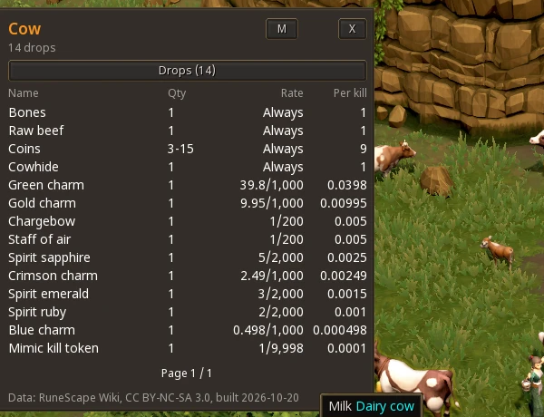
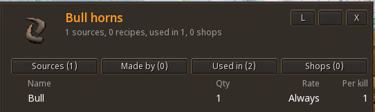
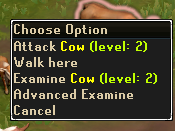

# Advanced Examine

A RuneScape 3 plugin for the official [RS Plugin Hub](https://developer.runescape.com/rs/). Right-click a
monster, object or item, choose **Advanced Examine**, and see what the RuneScape Wiki knows about it:
what it drops, where an item comes from, what makes it, what it's used in and who sells it. Every
entry links to the next one.

By [Nodexis Labs](https://github.com/NodexisLabs). **Status: in development and tested on the plugin
beta world; not yet submitted to the Plugin Hub.**







## What it does

- **Drops:** every drop with its quantity, the rate exactly as the wiki gives it, and the expected
  amount per kill. Sorted by chance. Approximate rates are amber. Rates the wiki only gives as words
  ("Rare", "Varies") are grey and never turned into a guessed number.
- **Items:** Sources, Made by, Used in and Shops tabs. Items you can open (caskets, crackers) get a
  Contains tab.
- **Linked:** click any row to open that item or monster, and Back to return.
- **Visuals:** a 3D model of the monster you examined, the item's icon for items, and an icon on
  every item row, all drawn by the game from its own assets.
- **Window:** drag it anywhere, switch between S/M/L sizes, and it remembers both.
- Works on NPCs, scenery and ground items. Backpack and bank items are next.

## No network, by design

The plugin makes **zero network requests** and needs no permissions. All data ships inside it as Lua
tables, built ahead of time from the wiki's structured [Bucket](https://meta.weirdgloop.org/w/Extension:Bucket)
tables (drops, recipes, shops, game ids). Players never touch the wiki, however many install it.

The wiki is volunteer-run infrastructure that every RuneScape tool depends on, so the build side is
kept small too:

- `rswiki-mirror/` holds one local copy of the tables. Only the mirror talks to the wiki: about 50
  requests for a first fill, then only pages that changed (one recent-changes check and a few batched
  queries per game update).
- It sends a descriptive User-Agent, makes at most 1 request a second, uses `maxlag`, never retries
  on errors, has a hard cap per run, and logs every request in a ledger.

## Layout

| Path | What |
|---|---|
| `plugin/` | the plugin: `main.lua` (menu hook), `window.lua` (UI), `views.lua` (what to show), `lookup.lua` (data access) |
| `plugin/data/` | generated data (CC BY-NC-SA 3.0, see its LICENSE) |
| `build_data.py` | builds `plugin/data/` from the mirror; `build/report.md` lists every dropped row and why |
| `rswiki-mirror/` | the local wiki mirror and its request ledger |
| `test_*.py` | tests: data lookups in Lua 5.4, the window against a stand-in UI, the mirror against a fake wiki |

## Try it on the plugin beta world

1. Join the beta world once ([Jagex's tutorial](https://developer.runescape.com/rs/tutorial/1helloworld.html)).
2. Copy `plugin/` to `C:\ProgramData\Jagex\RuneScape-BETA\dev_plugins\advanced-examine`.
3. In game, open the console (Alt + \`) and run `prf`, then `pon advanced-examine`.

## Rebuilding the data

```
python rswiki-mirror/grab.py                 # first fill of the mirror
python rswiki-mirror/rswiki_mirror.py update  # later: only pages that changed
python build_data.py              # mirror -> plugin/data, no wiki requests
python test_lookup.py             # needs: pip install lupa
python test_window.py
```

The mirror database itself is not in this repo.

## Credits and licences

- Data: [RuneScape Wiki](https://runescape.wiki), run by [Weird Gloop](https://weirdgloop.org), used under
  [CC BY-NC-SA 3.0](https://creativecommons.org/licenses/by-nc-sa/3.0/). Generated data in `plugin/data/`
  carries the same licence.
- Code: MIT, see `LICENSE`.
- Developed with AI assistance (Claude Code). The code is kept small, commented and readable for
  review, per Jagex's plugin guidelines.
- RuneScape is a trademark of Jagex Ltd. This project is not affiliated with or endorsed by Jagex or
  Weird Gloop.
